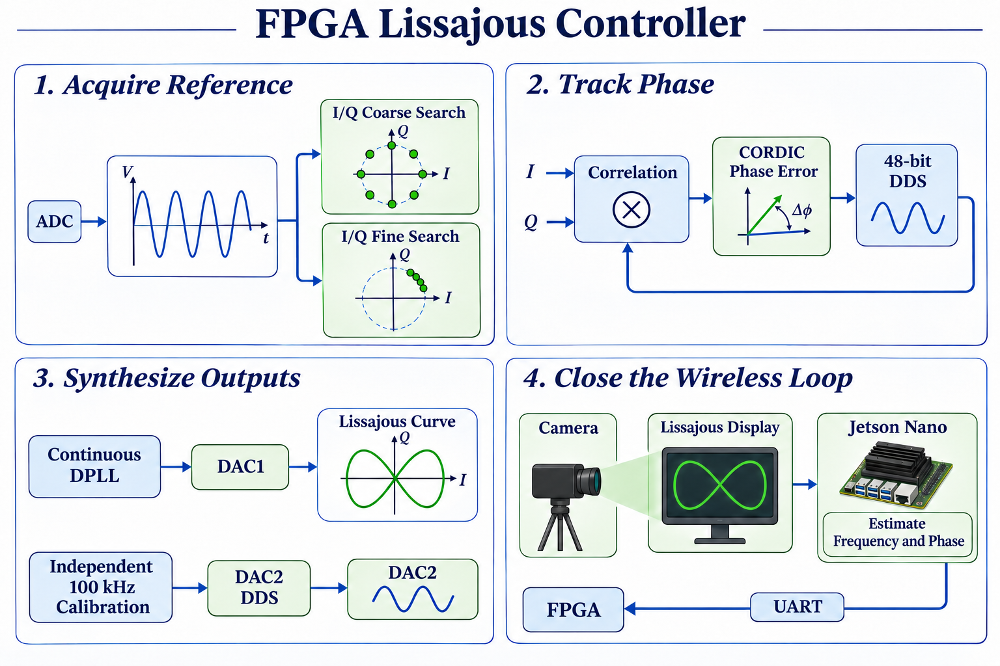

# FPGA Lissajous Controller

[中文](#中文) · [English](#english)



## 中文

2026 年全国大学生电子设计竞赛江苏赛区 F 题省冠军作品。系统在 FPGA 上从输入信号估计频率和相位，再合成示波器 Y 轴波形。原始信号送入 X 轴，通过同相、正交和二倍频三种模式生成直线、圆或椭圆、以及横向“∞”图形。硬件基线为 Mizar Z7 / XC7Z020。

### 有线跟踪与双 DAC

- **捕获和跟踪**。AD1 去中值、限幅后进入 I/Q 相关器。DPLL 按 1 kHz 步长粗扫，再按 100 Hz 步长细扫。锁定后通过 CORDIC 提取相角，用分块相位变化估计频偏，用绝对相位误差继续校正相位。
- **图形合成**。48 位 DDS 依据跟踪结果重新生成波形，经过相位模式选择和幅值缩放后由 DAC1 输出。相同通道增益下，同频正交对应圆，通道增益不同时对应椭圆。
- **独立标定**。KEY4 启动 100 kHz 参考标定。标定器利用分块相关相位估计时基偏差并冻结校正后的频率字。DAC2 利用标定结果输出 1、20.4、50、80.3 或 100 kHz 测试音。无线 DDS 也使用该标定结果。

### 视觉控制

Jetson Nano 从摄像头获取示波器图形，通过多帧融合和双侧精扫估计频率，再搜索绝对相位。FPGA 接收 UART 921600、8-N-1 命令，更新无线 DDS 的频率和相位。协议使用 `A5 5A` 帧头和 CRC-8/ATM，频率以 mHz 表示，角度使用 Q0.16 周。完整视觉相位闭环需要补回 `lissajous_phase_local.py` 并完成相机标定。 [UART 协议](docs/uart-protocol.md) · [Jetson 说明](vision/README.md)

### 源码与验证入口

| 入口 | 用途 |
| --- | --- |
| [lissajous_top.sv](rtl/lissajous_top.sv) | ADC、双 DAC、按键、UART 与多时钟域集成 |
| [continuous_iq_dpll.sv](rtl/continuous_iq_dpll.sv) | 频率捕获、连续相关与频相跟踪 |
| [reference_frequency_calibrator.sv](rtl/reference_frequency_calibrator.sv) | 100 kHz 标定与冻结频率字 |
| [wireless_uart_controller.sv](rtl/wireless_uart_controller.sv) | 无线模式状态机和 DDS 参数更新 |
| [sim/](sim/) · [phase_sim/](phase_sim/) | RTL 测试平台和频偏模型 |

在仓库根目录运行以下命令。RTL 仿真需要在 PATH 中提供 Icarus Verilog 和 `vvp`。

```powershell
python tools/wireless_uart_host.py --self-test
.\run_sim.ps1
```

UART 自检覆盖帧编解码和 CRC。RTL 测试平台覆盖 DPLL 捕获与跟踪、DAC2 标定输出以及无线协议。板级实现需要匹配的时钟与调试 IP，并按实际 AD/DA 板卡补齐管脚、电气和时序约束。 [构建与测试](docs/BUILD_AND_TEST.md) · [设计分析](docs/design-analysis.md) · [算法索引](docs/ALGORITHM_INDEX.md) · [赛题来源](docs/PROBLEM_SOURCE.md)

## English

This project won first place for Problem F in the 2026 Jiangsu regional electronic design contest. The FPGA estimates the input frequency and phase and synthesizes the oscilloscope Y signal. The original input drives X. In-phase, quadrature, and doubled-frequency modes produce a diagonal line, a circle or ellipse, and a horizontal figure eight. The wired hardware target is Mizar Z7 / XC7Z020.

### Wired tracking and dual DAC output

- **Acquisition and tracking.** AD1 samples are centered and clipped before I/Q correlation. The DPLL searches in 1 kHz coarse steps, then 100 Hz fine steps. After acquisition, CORDIC extracts the correlation phase. Block-to-block phase changes estimate frequency error, while absolute phase error guides phase correction.
- **Waveform synthesis.** A 48-bit DDS regenerates the tracked waveform. Phase selection and amplitude scaling feed DAC1. A quadrature signal produces a circle when the X and Y gains match, and an ellipse when they differ.
- **Independent calibration.** KEY4 starts calibration against a 100 kHz reference. The calibrator estimates the clock error from block correlation phases and freezes the corrected tuning word. DAC2 can output test tones at 1, 20.4, 50, 80.3, or 100 kHz. The wireless DDS also uses the calibrated timebase.

### Vision and UART

Jetson Nano observes the oscilloscope through a camera, combines frame estimates, refines the frequency with a two-sided sweep, and searches for the absolute phase. The FPGA updates its wireless DDS over 921600-baud 8-N-1 UART. Packets use an `A5 5A` sync word and CRC-8/ATM. Commands encode frequency in mHz and phase in Q0.16 turns. Full phase feedback requires restoring `lissajous_phase_local.py` and calibrating the camera. [UART protocol](docs/uart-protocol.md) · [Jetson guide](vision/README.md)

### Build and verify

Start with the [RTL top level](rtl/lissajous_top.sv), [DPLL](rtl/continuous_iq_dpll.sv), [reference calibrator](rtl/reference_frequency_calibrator.sv), or [UART controller](rtl/wireless_uart_controller.sv). Run the Python UART self-test and PowerShell RTL simulation shown under [源码与验证入口](#源码与验证入口). The simulator requires Icarus Verilog and `vvp`. Available benches cover acquisition, tracking, calibration output, and UART behavior.

A board build requires matching clock and debug IP plus pin, electrical, and timing constraints for the attached AD/DA hardware. [Build and test](docs/BUILD_AND_TEST.md) · [Design analysis](docs/design-analysis.md) · [Source and algorithm index](docs/ALGORITHM_INDEX.md) · [Contest problem](docs/PROBLEM_SOURCE.md)
